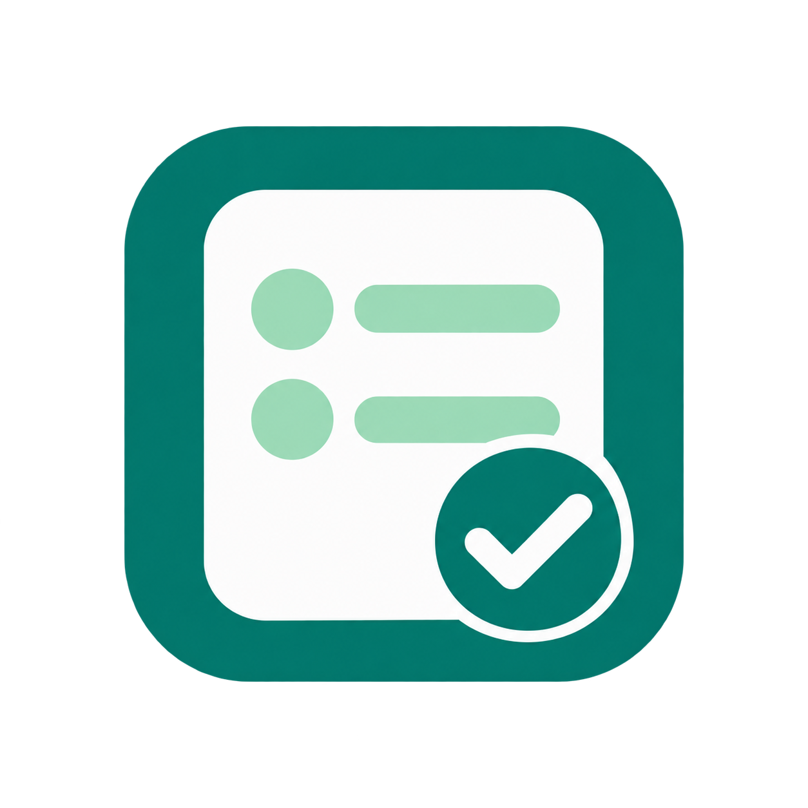

# Perguntas e decisões

Plugin local para reunir perguntas e classificações na barra lateral direita do Codex desktop, com apresentação opcional dentro da conversa.

A versão 0.3.8 mantém a barra lateral direita como apresentação principal. O modo no chat é opcional e usado somente quando solicitado. O aplicativo recebe preferências e recursos distintos para cada apresentação; o modo efetivamente confirmado continua sendo respeitado.

O formulário usa espaçamentos menores, alternativas mais próximas e caixas de texto/observações compactas. O tamanho das letras e os alvos para toque foram preservados.

O instalador 0.3.5 citado abaixo continua sendo a versão publicada. Para testar as melhorias desta fonte antes de um novo instalador, siga **Construir e conferir a fonte**. Os testes automatizados verificam protocolo e preservação de dados; a abertura visual nativa das duas apresentações ainda precisa ser conferida no aplicativo.



## Requisitos

Windows, Node.js 24 ou superior disponível pelo comando `node` e Codex desktop com plugins, MCP Apps e OpenAI Extensions. A sintaxe de instalação foi conferida na CLI 0.160.0. ChatGPT web, celular e nuvem não integram esta versão; outros anfitriões podem oferecer apenas parte das entregas.

## Instalação rápida em outro PC

1. Instale o Codex desktop e [Node.js 24 ou superior](https://nodejs.org/en/download).
2. Na página do projeto no GitHub, abra **Releases** e baixe **perguntas-decisoes-instalar-0.3.5.zip**.
3. Extraia o ZIP inteiro e abra **Instalar.cmd** dentro da pasta extraída.
4. Depois da confirmação, selecione **Perguntas e decisões** no menu `@` do Codex.

O pacote está construído e não exige npm ou compilação. O instalador confere os requisitos, conserva o catálogo na pasta local do perfil e registra o plugin e seu servidor. Não reinicia o aplicativo e não apaga rascunhos. Se faltar Node ou Codex, mostra a causa e encerra.

Uma aba antiga da ferramenta precisa ser fechada e aberta novamente. Para conferir os requisitos sem instalar, execute `Instalar.cmd --verificar`.

Se houver um catálogo do mesmo plugin registrado em outra pasta, a instalação para de forma visível para preservar o registro existente. Esse caso requer o fluxo de atualização da instalação anterior.

## Construir e conferir a fonte

Abra um terminal na pasta do projeto:

```powershell
node --version
npm ci
npm run verificar
npm run package:desktop
npm run verificar:desktop
```

O diagnóstico inicia o comando do próprio manifesto com banco isolado. Confere protocolo, quatro ferramentas visíveis, as duas apresentações e retomada do mesmo formulário. Isso não comprova abertura ou entrega na interface nativa.

## Instalar no Codex

Depois de construir:

```powershell
codex plugin marketplace add ./pacote
codex plugin add perguntas-decisoes@perguntas-decisoes-local
```

Os comandos registram o catálogo e instalam no seu perfil. Se `codex plugin` não existir, use a CLI compatível fornecida pelo aplicativo. O projeto não inclui nem altera o executável do Codex.

No Windows, este bloco usa diretamente a CLI do aplicativo e registra o servidor local para novas conexões:

```powershell
$motorPlugin = Get-ChildItem -LiteralPath "$env:LOCALAPPDATA\OpenAI\Codex\bin" -Filter codex.exe -Recurse | Sort-Object LastWriteTime -Descending | Select-Object -First 1 -ExpandProperty FullName
if (-not $motorPlugin) { throw 'A CLI do Codex desktop não foi encontrada.' }
& $motorPlugin plugin marketplace add ./pacote
if ($LASTEXITCODE -ne 0) { throw 'Não consegui registrar o catálogo.' }
$instalacaoPlugin = (& $motorPlugin plugin add perguntas-decisoes@perguntas-decisoes-local --json) | ConvertFrom-Json
if ($LASTEXITCODE -ne 0) { throw 'Não consegui instalar o plugin.' }
$servidorPlugin = Join-Path $instalacaoPlugin.installedPath 'server/servidor.mjs'
& $motorPlugin mcp add perguntas_decisoes_local -- node $servidorPlugin
```

O vínculo fica na configuração local do seu computador. Seu caminho não faz parte do pacote distribuído. O catálogo pronto usa os mesmos comandos de registro a partir da pasta extraída, sem etapa de construção.

Selecione **Perguntas e decisões** no menu `@` da conversa. Para abrir manualmente: **Ferramentas → Mais ferramentas → Plugins e MCPs → Perguntas e decisões**. A localização do menu depende da versão do aplicativo.

A renovação de conexões antigas depende do aplicativo. Salve os trabalhos antes de decidir reabrir o Codex. Nenhum script deste projeto reinicia o aplicativo.

## Uso pelo agente

Chame `criar_formulario` com alternativas comuns:

```json
{"titulo":"Classificação","perguntas":["Item A","Item B","Item C"],"tipo":"unica","opcoes":["Aprovar","Ajustar","Deixar pendente"]}
```

Para misturar tipos:

```json
{"perguntas":[{"texto":"Concorda?","tipo":"sim_nao"},{"texto":"Sua nota","tipo":"nota","min":1,"max":5},"O que deseja acrescentar?"]}
```

As ferramentas padrão são `criar_formulario` e `abrir_painel`, que abrem a barra lateral direita. Somente para um pedido explícito de uso no chat, chamar `criar_formulario_no_chat` ou `abrir_no_chat`. Reabrir o mesmo id troca apenas a apresentação, preservando respostas e observações. Ao criar, o modelo recebe identificador e quantidade; perguntas, rascunhos e operações internas ficam nos metadados da interface. As respostas entram no contexto quando a pessoa escolhe entregá-las.

Para medir os bytes das definições:

```powershell
node --input-type=module -e "import { FERRAMENTAS } from './src/servidor.mjs'; console.log(new TextEncoder().encode(JSON.stringify(FERRAMENTAS.filter(f => f._meta?.ui?.visibility?.[0] !== 'app'))).length)"
```

Bytes não são tokens. Interface construída e rascunhos não são repetidos na definição das ferramentas.

## Preencher e entregar

- Seis perguntas por página. Anterior conserva conteúdo; Próximo exige respostas da página.
- Sim/não, escolha única, múltipla, texto, nota, escala, número, data e hora.
- Alternativas visíveis em um clique; observações individuais e gerais opcionais.
- Entregas somente na última página.
- **Enviar ao chat:** solicita mensagem com o conjunto completo.
- **Inserir como anotação:** adiciona texto ao contexto do campo de mensagem, para acompanhar o que a pessoa escrever.
- **Anexar arquivo TXT:** adiciona recurso incorporado `text/plain`, com nome `respostas.txt`, ao contexto do campo de mensagem. A aparência depende do aplicativo; não equivale necessariamente a upload convencional.
- Modalidades não anunciadas ficam indisponíveis. Falhas são visíveis; entrega ambígua exige conferir a conversa antes de reenviar ou retomar.
- Trocas durante salvamento ou entrega aguardam a operação original. Não há seleção automática de outra conversa principal.
- Conflitos entre janelas conservam o texto local e oferecem duas escolhas explícitas: usar a versão salva ou guardar seu preenchimento sobre a versão atual. A confirmação perdida de uma preparação é conferida por sua chave antes de retomar.
- A lista oferece cem pendentes por vez e **Carregar mais formulários**.

## Armazenamento e limites

Rascunhos ficam em `%LOCALAPPDATA%/PerguntasDecisoes/rascunhos.sqlite`, fora do pacote e associados ao perfil Windows. O registro é removido após confirmação. Não há histórico próprio de entregas nem armazenamento remoto.

Limites individuais: até 1.000 perguntas; título de 200 caracteres; pergunta de 6.000; alternativa de 300; resposta e observação de 16.000; de 2 a 100 alternativas distintas; até 21 posições inteiras para nota ou escala.

Limites agregados em UTF-8: definição normalizada de 400.000 bytes; rascunho de 1.000.000; chamada MCP de 2.000.000 com margem de 4.096 para o envelope. Excesso não é truncado: a recusa fica visível e o texto permanece na tela. Reduza o conteúdo e confirme **Progresso guardado** antes de fechar; o banco mantém o último salvamento confirmado.

O transporte reserva 8.000.000 bytes para recusar chamadas acima do limite de uso. Mensagens acima dessa reserva violam o protocolo e podem encerrar a conexão.

O Worker HTTP é experimental e confia na identidade de um gateway autenticado. `npm run dev` é uma conferência em loopback; o projeto não fornece autenticação para expor esse servidor diretamente à internet.

## Distribuição

`npm run preparar:publicacao` gera `publicacao/perguntas-decisoes` por lista explícita de inclusão, verifica a cópia e recusa destinos já existentes ou links simbólicos. Publique somente essa cópia conferida; a pasta de desenvolvimento pode conter registros privados.

A cópia permite executar os mesmos comandos de construção. Dependências são instaladas por `npm ci`. Avisos e licenças das bibliotecas são preservados em `THIRD_PARTY_NOTICES.txt` no pacote.

A demonstração fictícia fica em `dist/web/inline.html`; exige anfitrião compatível para enviar mensagem e não instala o plugin.

[Contrato público](docs/specs/contrato-publico.md).

## Licença

[MIT](https://opensource.org/license/mit), conforme LICENSE. As bibliotecas conservam suas licenças e atribuições próprias.
